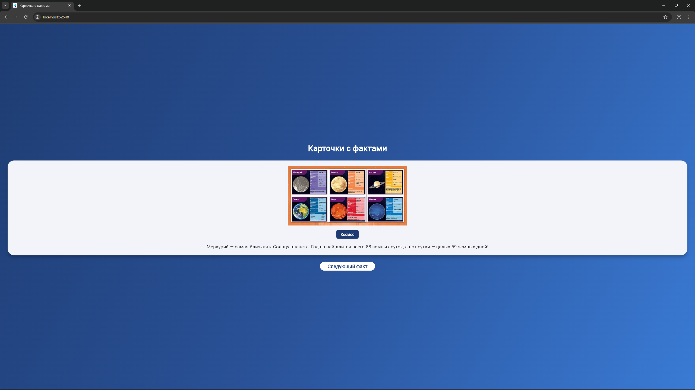

# Карточки с фактами (Facts Cards App)

Приложение на Flutter, которое показывает случайный интересный факт (о животных, космосе и истории) из заранее подготовленного списка при нажатии кнопки «Следующий факт».

## Автор

Морозов Владислав, группа ИСП-243, дата сдачи: 25.05.2026

## Стек и версии

- Flutter 3.50.1
- Dart 3.x
- Платформа: Web (Chrome)
- IDE: VS Code

## Скриншот



## Структура проекта

- `lib/main.dart` — точка входа, MaterialApp, тема, отключён DEBUG-баннер
- `lib/models/fact.dart` — модель `Fact` и список фактов
- `lib/widgets/gradient_background.dart` — StatelessWidget с LinearGradient
- `lib/widgets/fact_card.dart` — StatelessWidget карточки факта (принимает `Fact` через конструктор)
- `lib/widgets/fact_screen.dart` — StatefulWidget: хранит индекс, `setState()` + `Random`

## Как запустить

```bash
git clone https://github.com/qwezxc228/Flutter_Lab5.git
cd my_app_morozov
flutter pub get
flutter run -d chrome